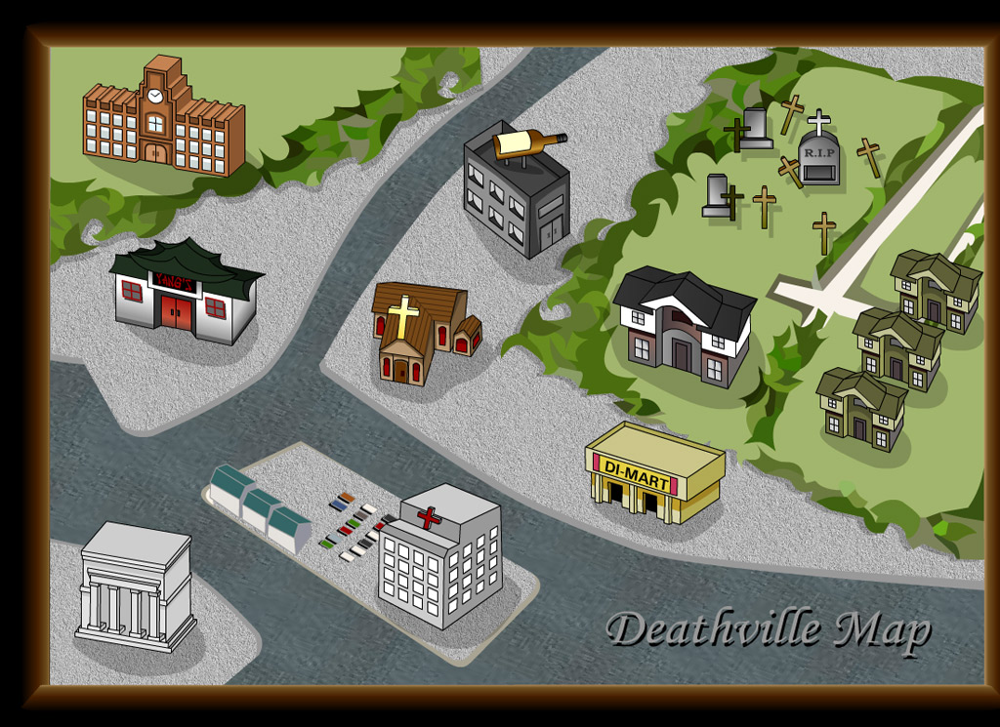
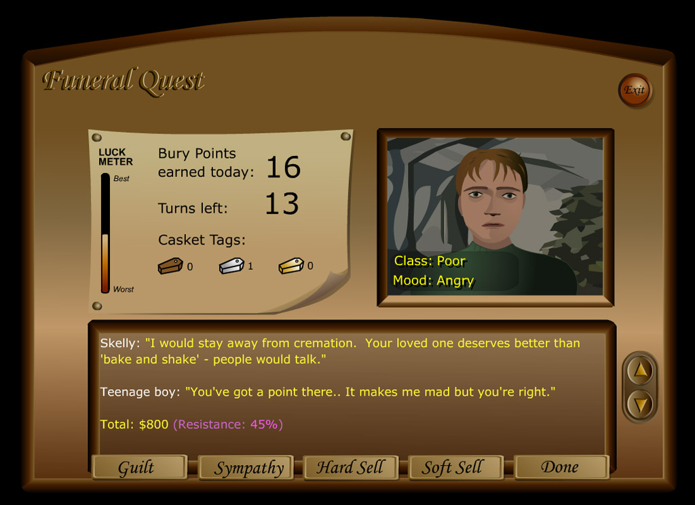
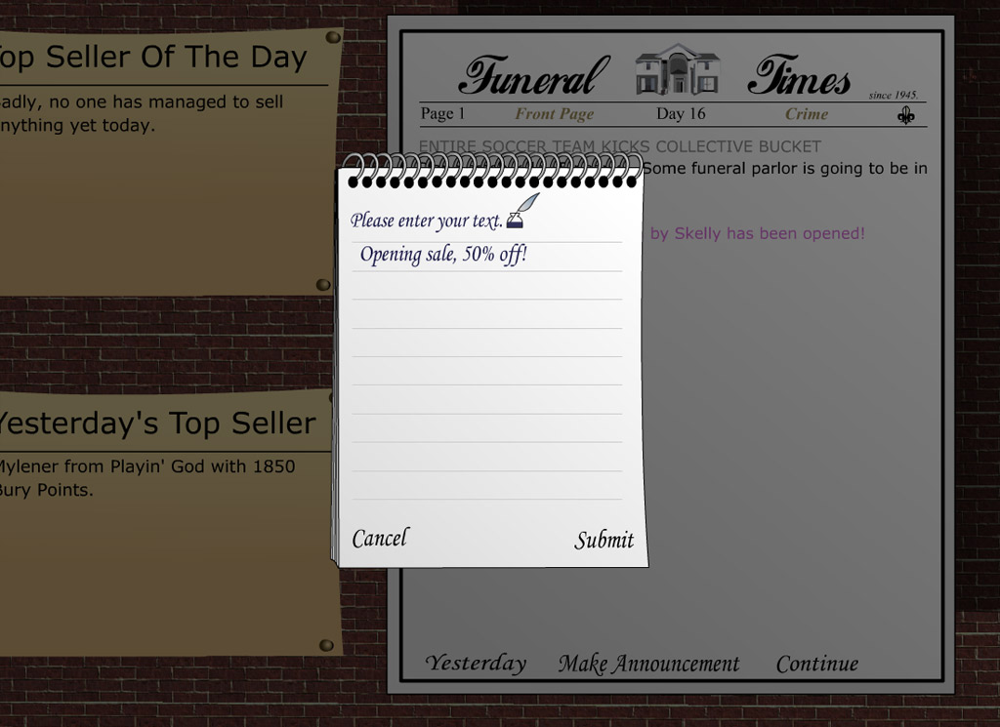
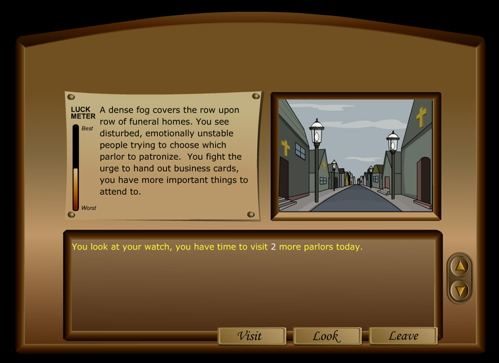

# Funeral Quest

Funeral Quest is a daily-turn game about rival funeral parlors, in the style of old BBS door games. You run a parlor in Deathville. Each day you have a handful of turns to wait for customers, upsell grieving relatives (sympathy, guilt, hard sell, soft sell, and knowing when to stop), spend your casket tags around town, and sabotage your rivals. The score is Bury Points.

This repository is a free, open-source **remaster**: the 2001 game (Robinson Technologies, by Seth A. Robinson) rebuilt in TypeScript so it runs in any modern browser, on one rules engine with two rulesets:

- **Classic**: the 2001 game reproduced faithfully (rules, text, art, screen layout), with the original 2001 text and art untouched. Complete, and checked against the original itself: `tools/oracle` compiles the original C++ server for Linux and plays it side by side with the port (213,350 steps with identical random draws, player records and words; [what is and is not verified](docs/classic-fidelity.md)). The few gameplay bug and exploit fixes are flags a town can turn off.
- **Expanded**: the same game grown up, with the features the original cut. In development; the engine work is under way in `packages/core`.

The original 2001 server, Flash client and content are kept untouched in [`legacy/`](legacy/README.md) as the reference for every rule.

## Play it in five minutes

You need [Node.js](https://nodejs.org) 24 or newer and [pnpm](https://pnpm.io) 12 (`corepack enable` gives you the right one).

```sh
git clone <this repository> && cd FuneralQuest-Remaster
pnpm install
pnpm play            # builds the web client, starts the server, serves both: http://127.0.0.1:8080
```

Open <http://127.0.0.1:8080>. The front door asks how you want to play.

### Online (a town of other players, on a server)

Choose **Play online**, then **New user** (or **Play as guest**), pick a name for yourself and your parlor, and read the paper. On the desk, **Wait for Customer** brings someone in; pick **Sympathy**, **Guilt**, **Hard Sell** or **Soft Sell** and finish with **Done**. The map takes you to the bank, the store, the cafe and your rivals. Open a second browser window as another player to see each other in the cafe and the rankings. Your progress is saved in `apps/client/.data/fq.sqlite`.

### Solo (offline, against computer rivals)

Choose **Play solo**. You make a career (your name, your parlor, how many rivals from none to seven, how good they are, a 30-day career or endless) and play it entirely on your own device: the rivals' days run in a Web Worker, careers are saved in your browser after every move (you can keep several, export one to a file, and import it on another device), and nothing needs a server. **End the Day** on the desk lets the rivals take their turns and starts the next morning's paper.

Solo needs no game server at all. It works from the installed app with no connection (the page keeps itself for offline use after its first visit) and from any static file host:

```sh
pnpm --filter @fq/client build                # the site is apps/client/dist-build
python3 -m http.server -d apps/client/dist-build 8000   # or any file host, served from the site root
pnpm --filter @fq/client dev                  # or: development server with hot reload, no game server needed for solo
```

### Museum mode (the original 2001 client)

The unmodified 2001 Flash client can play the new engine, in the same town as everyone else, through the [Ruffle](https://ruffle.rs) emulator:

```sh
pnpm play:museum     # as above, plus http://127.0.0.1:8080/museum/
```

The front door links to it when the server has it switched on. On a server of your own it is the `FQ_LEGACY_CLIENT` setting, off by default; see the [server README](apps/server/README.md#museum-mode-the-original-2001-client-in-the-same-town). The original sounds and music stay in `legacy/` and are only served when it is on (see [Licence](#licence)).

## Host a town

A server hosts any number of towns (Classic or Expanded rules; the original 2001 text in both), with accounts, a day scheduler, an admin API and SQLite storage. The quick way is Docker, which builds the web client and serves the whole game on one port:

```sh
cp apps/server/.env.example apps/server/.env     # set FQ_ADMIN_TOKEN (openssl rand -hex 32)
docker compose up -d --build
curl localhost:8080/health
```

Without Docker: `pnpm --filter @fq/client build`, then `FQ_CLIENT_DIR=apps/client/dist-build FQ_ADMIN_TOKEN=... pnpm --filter @fq/server dev` (or `build` then `start` for the bundled server). Put TLS in front with a reverse proxy. Towns, game settings, bans, snapshots and rollbacks, content packs and backups are covered in the [server README](apps/server/README.md).

## Repository layout

| Path                     | What is there                                                                                                                      |
| ------------------------ | ---------------------------------------------------------------------------------------------------------------------------------- |
| `packages/protocol`      | The `View` and `Action` types shared by the engine, server and clients. Text is rich-text spans, never HTML.                       |
| `packages/core`          | The rules engine: pure, deterministic, no I/O. Classic ported line by line from `legacy/source`; Expanded in progress.             |
| `packages/content`       | Content packs (`classicPack`, the original text; `expandedPack`) converted from `legacy/dist/*.txt`, with the importer and schema. |
| `packages/bots`          | AI rival parlors that play from the same Views a person sees.                                                                      |
| `packages/solo`          | Offline Solo mode: a whole town in a Web Worker, save slots, save files.                                                           |
| `packages/legacy-compat` | The bridge that lets the original Flash client play the new engine (museum mode).                                                  |
| `apps/server`            | The game server: Fastify, WebSocket, SQLite, accounts, towns, the day scheduler, the admin API.                                    |
| `apps/client`            | The web client (React, Vite): front door, the game in three layouts, Solo mode, PWA, Playwright tests.                             |
| `tools/sim`              | The balance simulator: many towns of rival bots, a report, invariant and exploit checks.                                           |
| `tools/extract`          | Exports the original assets and text from `legacy/` (art as SVG, tables as data).                                                  |
| `tools/oracle`           | The fidelity oracle: the original C++ compiled for Linux (32-bit) and driven side by side with the port.                           |
| `packages/audio`         | The sound: the Synth pack generated from code, the cue map, and the tools for the optional Studio pack.                            |
| `legacy/`                | The original 2001 server, Flash client and content, untouched. [Its README](legacy/README.md) is the original one.                 |
| `docs/`                  | The plan, the rules, balance reports and reference notes (below).                                                                  |

## Working on it

```sh
pnpm check                         # lint, typecheck and tests for every package
pnpm e2e                           # builds the client and runs the Playwright suites (online, solo, museum, Expanded) in Chromium, Firefox and WebKit
pnpm dev:server                    # game server with auto-restart, http://127.0.0.1:8080
pnpm dev:client                    # web client with hot reload, http://localhost:5173 (talks to the dev server)
pnpm sim --days 30 --towns 20      # balance simulation (tools/sim)
```

Read [`CLAUDE.md`](CLAUDE.md) first: it holds the ground rules (strict TypeScript, Classic rules ported line by line with source citations, game text as content data, no original sounds in the new tree). Each package and app has its own README. CI (`.github/workflows/ci.yml`) runs lint, typecheck and tests, builds the client, and runs the Playwright suites, keeping traces of any failure.

### Where the plan and the rules are

- [`docs/STATUS.md`](docs/STATUS.md): what is finished, what is only tested, what has never been run, and what needs a human.
- [`docs/REMASTER_PLAN.md`](docs/REMASTER_PLAN.md): what the remaster is, what the review of the original found, the phases and the decisions.
- [`docs/classic-rules.md`](docs/classic-rules.md): the Classic rules specification, each section marked Reviewed or Ported against the original source, and whether the oracle verified it; section 9 lists the gameplay fixes.
- [`docs/classic-fidelity.md`](docs/classic-fidelity.md): the oracle's comparison with the original C++, every difference it found and what remains unverified.
- [`docs/expanded-rules.md`](docs/expanded-rules.md): the Expanded ruleset.
- [`docs/DECISIONS.md`](docs/DECISIONS.md): questions waiting on the owner, and the answers given.
- [`docs/balance/`](docs/balance): the simulator's baseline report for Classic.
- [`docs/security.md`](docs/security.md) and [`docs/performance.md`](docs/performance.md): the server's threat model and the performance budget.
- [`docs/release/`](docs/release): store, build and launch checklists.
- [`docs/reference/`](docs/reference): notes on the original Flash client (its structure, protocol script and sound inventory).

## Licence

- The source code uses the [Proton SDK license](license.txt) (BSD-style), which permits reuse and porting subject to its attribution and other terms.
- Akiko Robinson's artwork, including the Flash vector art that the Classic art pack is exported from, is also released under the Proton SDK license. Please credit her when using it.
- **The sounds and music in the Flash files are licensed only for Funeral Quest and are not covered by that license.** The remaster does not reuse them: nothing from `legacy/` is copied into the new code or any build, and the only way they reach a player is museum mode, which serves the original client from `legacy/` as it is, only when you switch it on.
- The remaster's own sound comes in two packs, chosen in Settings: **Synth** (the default), generated by this repository's code and under its licence, and **Studio** (`assets/audio-studio/`), generated with ElevenLabs, whose redistribution terms the owner has yet to confirm ([its ledger](assets/audio-studio/LICENSES.md)); a build includes Studio only when asked to.

This product includes software written by Seth A. Robinson ( www.rtsoft.com ).

The remaster is an independent project and is not affiliated with or endorsed by Robinson Technologies.

## Credits

The original game:

- Seth A. Robinson: programming, design
- Akiko Robinson: art
- Greg Smith: additional design
- Joe Johnston, Foxxie: additional writing

Funeral Quest is copyright 2001 Robinson Technologies. The full credits, including the remaster's, are in [`CREDITS.md`](CREDITS.md) and on the game's own credits page. The original [source release blog post](https://www.codedojo.com/?p=2189) and the [Funeral Quest website](https://www.rtsoft.com/pages/funeral_quest.php) have the history. The community PHP port, [Funeral Quest for PHP and cPanel](https://github.com/auzziejay/funeral-quest-web) by auzziejay, is a separate project that serves the original client under Ruffle.

## Screenshots

Screenshots from the original game, courtesy of the [Funeral Quest website](https://www.rtsoft.com/pages/funeral_quest.php). Artwork by Akiko Robinson. Click an image to view it at full size.

| Deathville town map                                                                                                         | Customer negotiations                                                                                               |
| --------------------------------------------------------------------------------------------------------------------------- | ------------------------------------------------------------------------------------------------------------------- |
| [](docs/screenshots/fq_town.jpg) | [](docs/screenshots/fq_customer.jpg) |

| News and announcements                                                                                                   | Visiting rival parlors                                                                                                      |
| ------------------------------------------------------------------------------------------------------------------------ | --------------------------------------------------------------------------------------------------------------------------- |
| [](docs/screenshots/fq_news.jpg) | [](docs/screenshots/fq_player_attack.jpg) |
