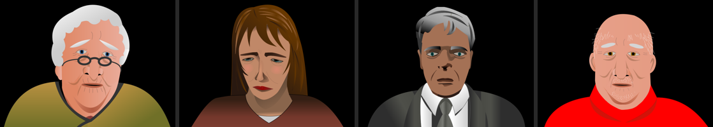
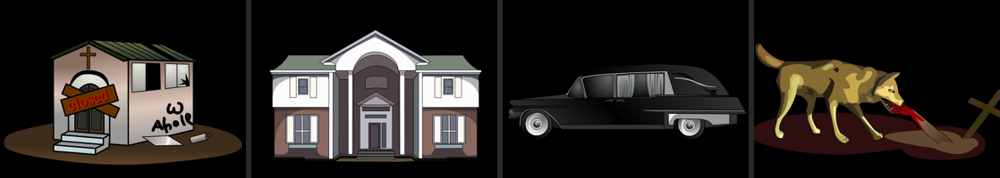
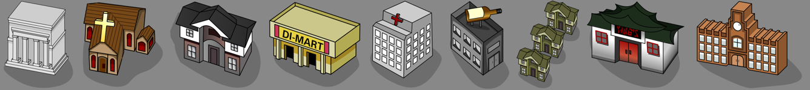
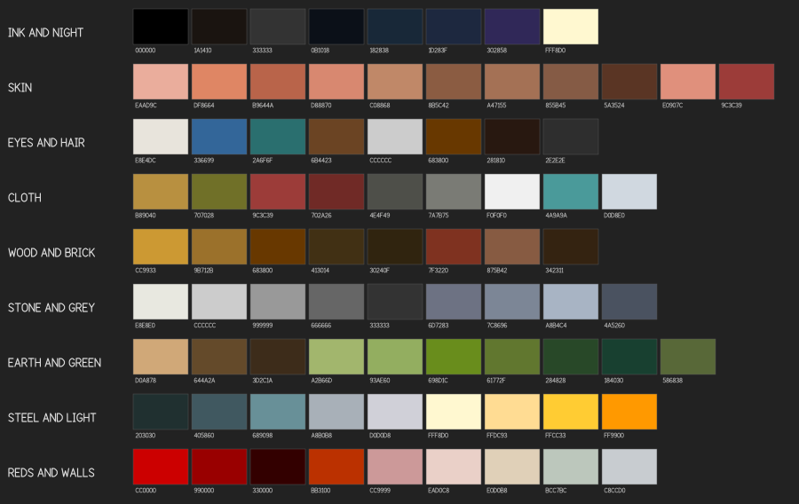
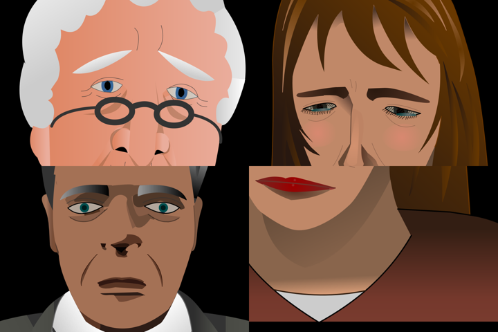
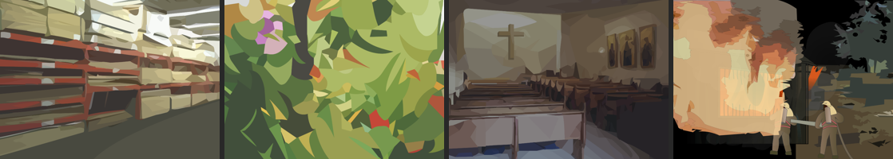
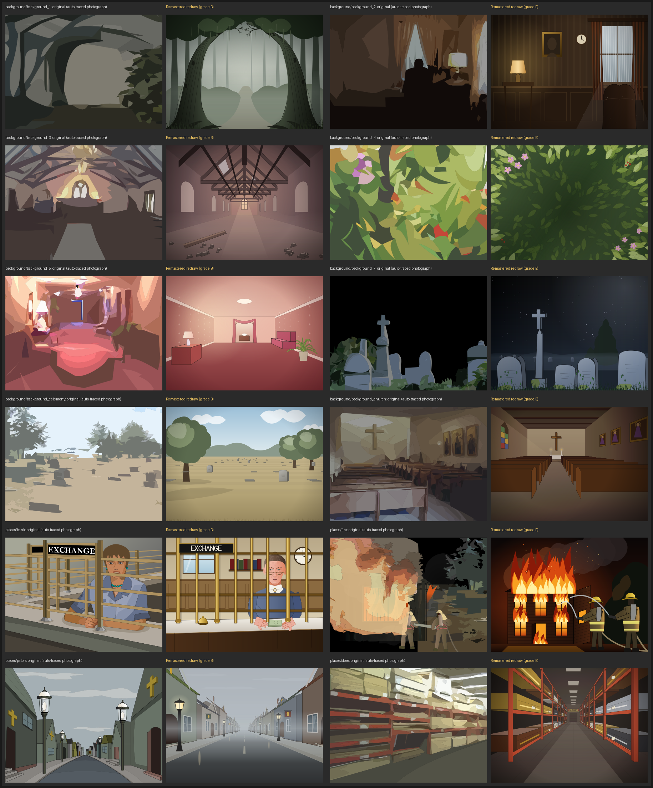

# Remastered art: style guide

The Remastered pack is new vector art drawn to sit beside Akiko Robinson's 2001 artwork for Funeral Quest, not to replace its look. Everything here was read off her own hand-drawn pieces in `assets/classic/` (rendered with `rsvg-convert` and read as SVG text). Where her pieces disagree, the hand-drawn scenes and portraits win over the auto-traced photographs, which are the reason this pack exists.

New art is credited "FuneralQuest Remastered project, in the style of Akiko Robinson's original art", CC BY 4.0.

## 1. What the originals are

Three families, one hand:

- **Portraits** (`people/*`): a head and shoulders, centred, the shoulders cut by the bottom edge, on a transparent stage that the game shows on black (or over a backdrop). Semi-realistic caricature: big heads, long faces, heavy-lidded, droopy, slightly grotesque, never cute. No outline around the face; form is built from flat planes of skin a step darker or lighter, plus hairline wrinkles.
- **Scenes** (`places/desk`, `hospital_desk`, `hospital_room`, `embalming-room`, `creamation_oven`, `yangs`, `bar`): clean clip-art interiors. Flat fills, two-to-four-stop linear gradients on walls, glass and metal, thin dark outlines on furniture and objects, cast light as translucent white wedges.
- **Objects and buildings** (`funeral_home(*)`, `hearse/*`, `stuff/*`, `ui/building-*`): the most outlined family. A dark outline around every part, flat fills with one gradient per face, a soft translucent shadow on the ground.

## 2. Palette

The values are sampled from the originals (the source file of each is in `tools/art/palette.mjs`; new art uses those names, never raw hex). The rules:

- **Muted and earthy.** Skin is salmon-to-umber, never pink-white; greens are olive and moss; wood is ochre to near-black brown; reds are blood and brick, the pure `#cc0000` only on lanterns, signs and the occasional sweater.
- **Black surrounds.** The stage is black. Night scenes fall to `#0b1018`-`#302858` blues, never to grey. Interiors fall to black at the edges or behind doorways.
- **Cold for death, warm for money.** The embalming room's steel blues (`#203030`-`#d0d0d8`) for clinical places; lamp yellows (`#fff8d0`-`#ffcc33`) for lamps, gold, cash and church glass.
- **One accent per picture.** A picture is mostly one family with one accent: Yang's is grey-white with red; the bar is grey with a dark red floor; the desk is ochre with a blue window.

## 3. Line

- **Figures** (faces, hands, hair): almost no outline. Where an edge needs help (a jaw against a dark collar, the lips) a 0.5-0.8 px line in a darker tone of the same colour (`skinMedLine` on skin), never black.
- **Objects and furniture** in scenes: 0.6-1.2 px at the 550 x 400 stage, in `ink` (`#1a1410`) or a dark tone of the fill. Interior detail (drawer seams, panel lines) at half that.
- **Buildings, signs, vehicles, map icons**: 1.2-2 px at 550 wide (about 1.3 px at the icons' own ~116 px size); black or `ink`. Outlines join round.
- **Wrinkles, folds, hair strands**: 0.3-0.6 px, translucent or in a mid tone; they suggest, they do not draw.

## 4. Fills and gradients

- Every surface is a flat fill or a **linear gradient of two to four stops**, mostly across a plane in the direction the light falls (left-to-right on faces and walls, top-to-bottom on floors and skies). Radial gradients only for glows, blush and lamp light.
- **Cel shading on figures**: one shadow plane per form (under the brow, beside the nose, under the cheekbone, under the jaw, on the neck), one tone darker, with soft edges only where the original uses a gradient (blush, neck).
- No noise, no texture fills, no blur except for fog and glow (a few `feGaussianBlur` uses; the originals faked fog with translucent white shapes, and so do we where we can).

## 5. Light and perspective

- **Light comes from the upper left** in almost every original (the faces' lit side is screen left on `m_old`, `f_old`; buildings' left faces are the light ones). Keep it there unless a lamp in the picture says otherwise.
- **Scenes are eye-level, one-point perspective** with the vanishing point near the centre (the parlor street, the church, the hospital room); or a flat elevation (Yang's, the oven, the desk) seen almost straight on. No wide-angle distortion, no Dutch angles.
- **Map buildings** are the oblique "isometric" of `ui/building-*`: front face toward the lower left, side face receding to the upper right at about 25-30 degrees, roof seen from above, the light face to the left, a translucent black (`fill-opacity .2`) shadow blob falling to the lower right.
- **Leave the centre free in backdrops.** `background_1`-`_4` are drawn behind a customer's bust; the picture's interest is at the edges and the middle third is calm, mid-to-dark, so a head reads against it.

## 6. Faces and hands

- **Head**: long, slightly jowly, often wider at the jaw than the temples for the old; a single skin gradient left (lit) to right. Ears simple, a darker inner shape.
- **Eyes**: an almond of off-white (never pure white), a small iris in a muted blue, teal or brown with a black pupil, a dark tapered upper lid that covers the top of the iris (the heavy, tired look), a hairline lower lid and one or two bag lines under it. Brows are solid tapered shapes, inner ends raised (worried) or knitted.
- **Nose**: no outline; a shadow plane down one side, a lit tip, two small dark nostril shapes.
- **Mouth**: small and thin, slightly down at the corners; lips a soft red-brown gradient (strong red only for the made-up women); a shadow under the lower lip.
- **Wrinkles**: thin darker lines on the forehead, crow's feet, nasolabial folds, all translucent.
- **Hair**: a dark base mass, then two or three lighter strands (curved tapered shapes) on the lit side; curly white hair is a scalloped silhouette with a grey-to-white gradient.
- **Clothes**: a big simple shape with one gradient and a few fold lines; collars and lapels as flat lighter shapes.
- **Hands**: flat skin with two or three cel tones and a thin warm-brown outline (`hospital_desk`), knuckles as tone patches, never a five-sausage glove.

## 7. What to avoid

The twelve auto-traced photographs show what not to do: hundreds of posterised blobs with no edges, no light direction and no drawing, which go muddy next to the portraits. Also avoid:

- Perfect geometry where the originals are hand-drawn (rows of identical circles, rulers-straight hedges, symmetric trees).
- Pure white and pure black inside a figure; saturated primaries outside signs and lanterns.
- Outlines on faces; thick outlines on scenes; gradients with more than four stops or on every shape.
- Text as live text. Sign lettering is drawn as paths (`tools/art/font.mjs`), in capitals, hand-lettered.
- Bitmaps, external references, embedded fonts, filters beyond blur.

## 8. Format

- 550 x 400 `viewBox="0 0 550 400"` for every picture; transparent where the original is (portraits, the parlor buildings), black-filled for full scenes.
- Map building icons use their own small viewBox like `ui/building-*`; HUD icons use `0 0 48 48`.
- Standalone: one `<svg>`, its own `<defs>`, nothing outside the file.

## 9. The rules applied

The Remastered redraws beside the traced originals they replace (`assets/remastered/comparisons.png`, the whole set in `assets/remastered/contact-sheet.png`):

