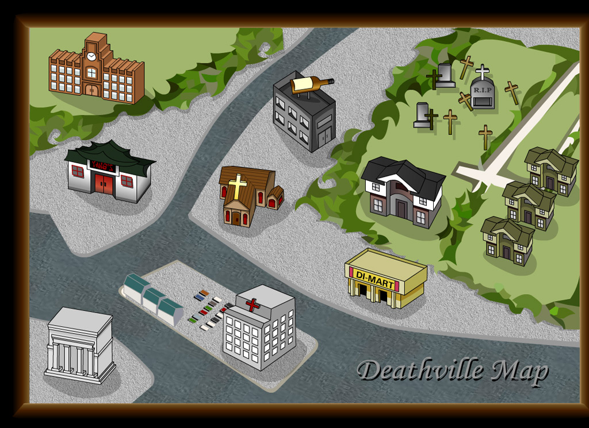
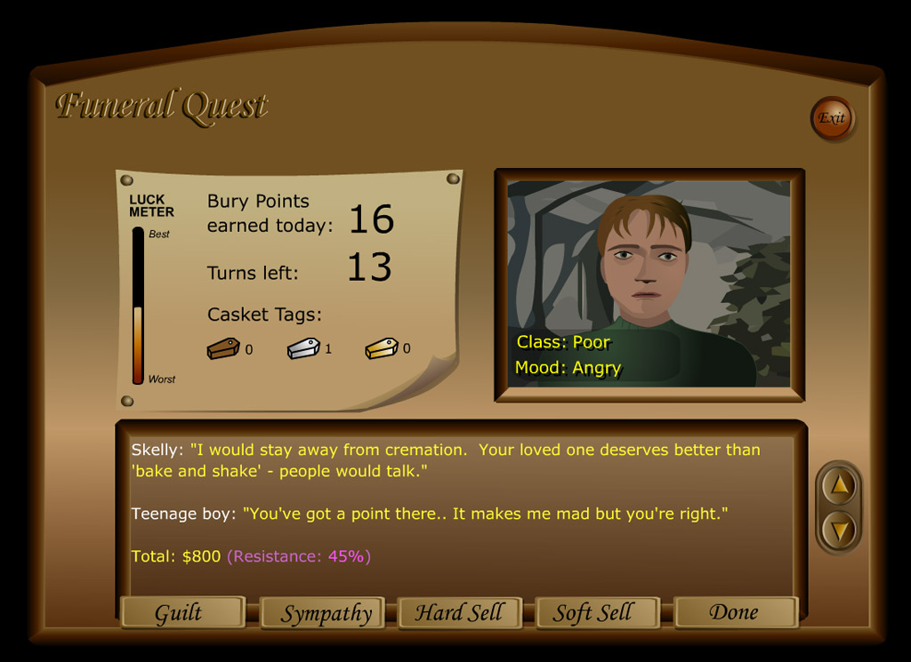
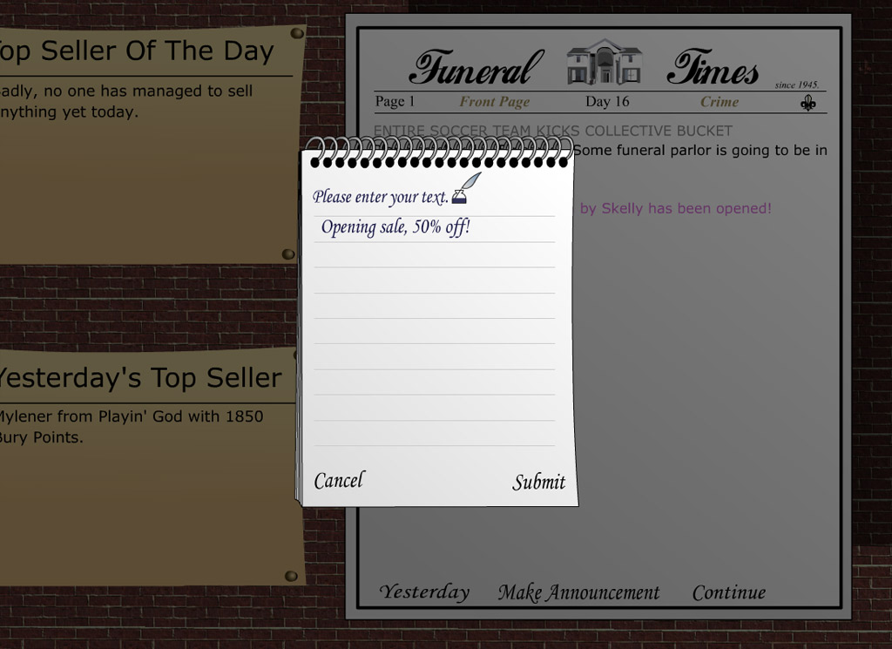
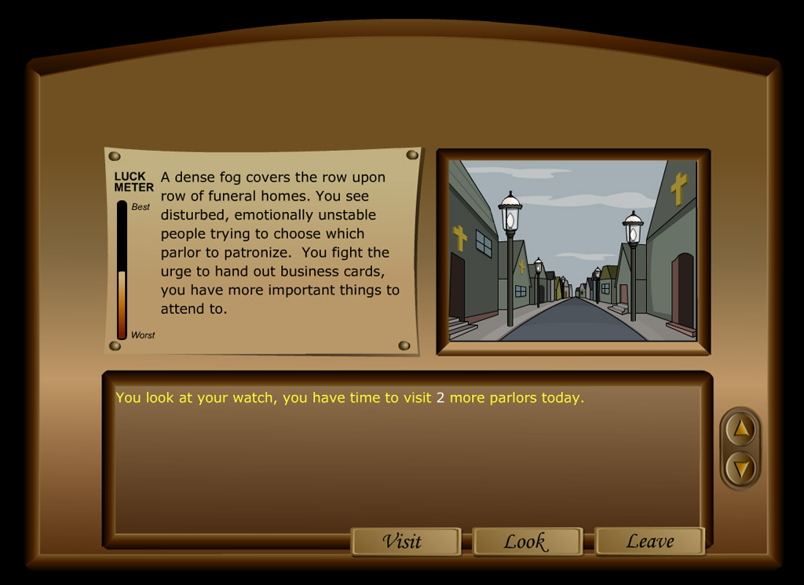

# Funeral Quest: the original 2001 release

> This is the original README of the source release, kept for the legacy server and Flash client that live in this directory (`legacy/source`, `legacy/dist`). Nothing in `legacy/` is edited: it is the reference for every rule in the remaster. For the remaster (the web game you can play today), see the [main README](../README.md).

Funeral Quest is a web-based, daily-turn multiplayer game in the style of old BBS games. It lets real humans compete in the cutthroat world of the death care industry by running rival funeral parlors.

I originally released the source because someone wanted to look at it for his own clone (Hi Richard!), but also so the game could live on in its own way. Feel free to port it to anything! See [License](#license) for the source and asset terms.

For background and help setting up the original server, see the [source release blog post](https://www.codedojo.com/?p=2189). The [Funeral Quest website](https://www.rtsoft.com/pages/funeral_quest.php) has more information and links to community servers.

## Screenshots

Screenshots from the original game, courtesy of the [Funeral Quest website](https://www.rtsoft.com/pages/funeral_quest.php). Artwork by Akiko Robinson. Click an image to view it at full size.

| Deathville town map | Customer negotiations |
| --- | --- |
|  |  |

| News and announcements | Visiting rival parlors |
| --- | --- |
|  |  |

## Community web port

[Funeral Quest for PHP and cPanel](https://github.com/auzziejay/funeral-quest-web) by auzziejay reimplements the server in PHP and uses the original Flash client through the bundled Ruffle emulator, allowing play in modern browsers. Visit the project's README for hosting instructions, requirements, and a live demo link.

## Original server warning

This repository contains the original Windows/MFC server and Flash client. The server is a home-built HTTP server using old code, so assume it could be hacked or exploited. Avoid running it publicly on a machine with sensitive information.

Player passwords are stored unencrypted and are visible to the server administrator. The original client requires a Flash-compatible runtime; the community port above includes Ruffle for modern browsers.

## Changes made for this source release

- Upgraded the projects to Visual Studio 2019 (the free edition works fine).
- Removed the dependency on StringEx, which no longer worked after Microsoft's CString changes.
- Removed the unused Vector3 type from the scripting engine, eliminating a dependency on old DirectX math code left over from Teenage Lawnmower.
- Stripped out DRM and protection code.
- Removed subprojects such as FQStress (the stress tester) and the DRM server system.

## Notes

- In my original testing, the "Play local" button worked on localhost only when the server used port 80. Port 82 didn't work; I'm not sure why.
- Multiplayer communication uses HTTP polling, with no special sockets. The server does not support HTTPS directly, but it should be possible to put it behind an HTTPS proxy.
- The Flash client and graphics are included.
- Flash source files (`.fla`) are under `dist/`. The built-in web server exposes `dist/public/`, which contains the compiled Flash (`.swf`) files.
- The `.c` files in `dist/script/` use a C-like scripting language, the same one used in Teenage Lawnmower. The server interprets them directly; they are not compiled or sent to players.
- The scripting system and a few other components link against Compressed File Library (CFL3, written by Jari Komppa under the zlib license), which is included.
- Microsoft's SAPI text-to-speech library is included for linking.
- The server GUI uses MFC (Microsoft Foundation Classes), which makes porting it to Linux more involved.

## How to compile the original server

1. Install Visual Studio 2019 with C++ and the Windows 10 SDK.
2. Open `source/fq.sln` and build either Debug or Release. Both should produce `dist/fq.exe`.
3. Run `dist/fq.exe` to start the server. The "Logon Channel 1" button opens the local client in your browser; playing requires a Flash-compatible runtime.

## License

- The source code uses the [Proton SDK license](../license.txt), which permits reuse and porting subject to its attribution and other terms.
- Akiko Robinson's artwork, including the Flash vector art, is also released under the Proton SDK license. Please credit her when using it.
- The sounds and music in the Flash files are licensed only for Funeral Quest and are not covered by that license.

## Credits

- Seth A. Robinson - Programming, design
- Akiko Robinson - Art
- Greg Smith - Additional design

Funeral Quest is copyright 2001 Robinson Technologies.
